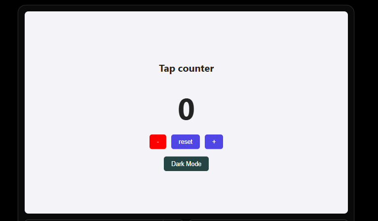

# Tap Counter

A simple counter app with a light/dark theme toggle, built to practice React state and the basics of React.

**Live demo:** [tap-counter-iota.vercel.app](https://tap-counter-iota.vercel.app/)



## Features

- Increase, decrease and reset the counter
- The number turns green when positive and red when negative
- Toggle between light and dark mode

## Tech used

- React
- Vite
- CSS
- GitHub Actions (CI) and Vercel (deployment)

## What I practiced

- `useState` and the updater form (`setCount((prev) => prev + 1)`)
- Handling events with `onClick`
- Conditional rendering and conditional class names
- Deriving values from state instead of storing them

## Run it locally

```bash
git clone https://github.com/SIRUP1999/Tap-counter.git
cd Tap-counter
npm install
npm run dev
```

Then open the local link that Vite prints, usually `http://localhost:5173`.
